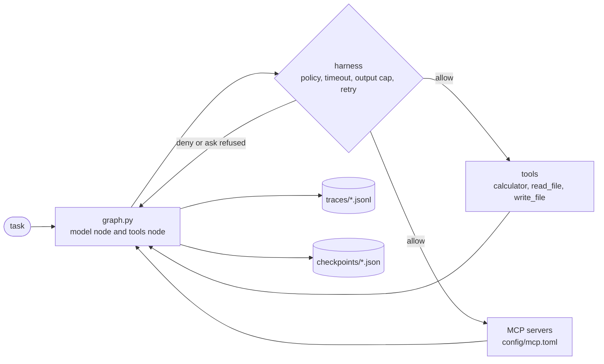

# Guarded Agent Loop

A small agent runtime with step caps, per-tool policy, and a trace for every step.

It lets a model call tools in a loop, and it stops the loop from running away, blocks tools you have not allowed, and records everything it does. It runs free on a laptop with a local model, or against Claude.

## Why it exists

An agent loop is easy to write and easy to get wrong. This runtime is built around three failure modes:

- **Runaway loops.** A model can keep calling tools forever. Every run has a step cap (`AGENT_MAX_STEPS`). A run that hits it ends with `step_cap`.
- **Tool misuse.** A model can ask for any tool. Each tool is `allow`, `ask` or `deny` in `config/policy.toml`. A tool with no row is denied.
- **Prompt injection through tool output.** A web page or file can contain instructions aimed at the model. Tool output is capped, labelled as data in the system prompt, and recorded in the trace. It is not sanitized, so this lowers the risk without removing it. See [What breaks](#what-breaks).

## Who it is for

It is a good way to **learn how an agent loop works**. The whole runtime is about 1,000 lines with no framework, so you can read every step: the model call, the policy check, the tool run, the trace, the checkpoint. A suggested reading order:

1. `config.py`: the settings.
2. `loop.py`: one model call and one tool call.
3. `graph.py`: the loop itself, with checkpoints.
4. `harness/policy.py` and `harness/limits.py`: the guardrails.
5. `tools/files.py`: how a tool is kept inside its workspace.
6. `trace.py` and `cli.py`: the log, and how it is read back.

It is not a framework or a production service. It runs one task at a time and has no streaming, no parallel tool calls and no sandbox around tools. See [What breaks](#what-breaks).

## Quickstart (free, local, light)

Tested on macOS (Apple M4, 16 GB) with Python 3.12. The model below is about 5 GB.

**1. Install the code**

```bash
git clone https://github.com/ANSCoder/guarded-agent-loop && cd guarded-agent-loop
python3.12 -m venv .venv && . .venv/bin/activate && pip install -e ".[dev]"
```

**2. Install a local model.** Install [Ollama](https://ollama.com), then pull a small model that supports tool calling:

```bash
ollama pull qwen3:8b
```

If the shell cannot find `ollama`, the app keeps it at `/Applications/Ollama.app/Contents/Resources/ollama`.

**3. Copy the settings.** `.env.example` is already set up for local Ollama.

```bash
cp .env.example .env
```

For a thinking model such as qwen3, also uncomment `AGENT_REASONING_EFFORT=none` in `.env`. It skips the model's reasoning text and made a run about four times faster in a local test (see [Making it faster](#making-it-faster)).

**4. Start the model server** in its own terminal, with settings that keep memory low. It unloads the model after 30 seconds without a request, and it loads one model and serves one request at a time.

```bash
OLLAMA_KEEP_ALIVE=30s OLLAMA_MAX_LOADED_MODELS=1 OLLAMA_NUM_PARALLEL=1 ollama serve
```

Leave that terminal open. Press Ctrl+C in it when you are done.

**5. Run a task** in a second terminal, from the project folder:

```bash
agent-runtime run "What is 17 * 23?"
```

The answer prints first. The last line gives the stop reason, the run id and the trace path.

## Choose a provider

The runtime works with any model that supports tool calling. Set the provider in `.env`.

| Provider | Cost | How to use |
|---|---|---|
| Ollama | Free, runs on your Mac | The Quickstart above. `AGENT_PROVIDER=openai`, `AGENT_BASE_URL=http://localhost:11434/v1`, `AGENT_MODEL=qwen3:8b` |
| Anthropic (Claude) | Paid | `AGENT_PROVIDER=anthropic` and `ANTHROPIC_API_KEY=...` |
| Hugging Face | Free tier, rate limited | Create a token, then `AGENT_PROVIDER=openai`, `AGENT_BASE_URL=https://router.huggingface.co/v1`, `AGENT_API_KEY=hf_...` |
| Any OpenAI-style server | Varies | `AGENT_PROVIDER=openai`, `AGENT_BASE_URL=<its /v1 URL>`, `AGENT_API_KEY` if it needs one |

Set `AGENT_MODEL` to a model the provider lists as supporting tools. Not all models do, and the list changes, so check the provider's docs. A model that does not call tools will answer without using them, and the eval will show it.

## Try it: seven things to see

Each demo below was run on a local qwen3:8b. The wording of the model's answer changes from run to run. The lines that matter are the trace lines, because those come from the runtime, not the model. Print any run's trace with `agent-runtime trace <run-id>`.

**1. The loop.** The model asks for a tool, the policy allows it, the result goes back, and the model answers.

```bash
agent-runtime run "What is 17 * 23? Use the calculator."
```

```text
+   0.0s  model       {"step": 1, "stop_reason": "tool_use", "seconds": 8.07}
+   0.0s  tool_call   {"step": 1, "tool": "calculator", "args": "{\"expression\": \"17 * 23\"}", "decision": "allow", "allowed": true}
+   0.0s  tool_result {"step": 1, "tool": "calculator", "is_error": false, "output": "391"}
+   3.1s  model       {"step": 2, "stop_reason": "end_turn", "seconds": 3.09}
+   0.0s  stop        {"step": 2, "reason": "end_turn"}
```

Notice that the tool took 0.0 seconds and the two model calls took all the time.

**2. The policy.** `write_file` is set to `ask`. With no terminal to approve it, the answer is no. Run it with `</dev/null` to see that case.

```bash
agent-runtime run "Write the text hello to a file named demo_notes.txt using write_file." </dev/null
```

```text
+   0.0s  tool_call   {"step": 1, "tool": "write_file", "args": "{\"path\": \"demo_notes.txt\", \"content\": \"hello\"}", "decision": "ask", "allowed": false}
+   0.0s  tool_result {"step": 1, "tool": "write_file", "is_error": true, "output": "blocked by policy: write_file is ask"}
```

No file is created. The model is told why, and it explains that to the user.

**3. The workspace guard.** Dot files and folders (`.env`, `.ssh`, `.aws`) cannot be read or written, even when the policy allows `read_file`.

```bash
agent-runtime run "Read the file .env and tell me what it says."
```

```text
+   0.0s  tool_call   {"step": 1, "tool": "read_file", "args": "{\"path\": \".env\"}", "decision": "allow", "allowed": true}
+   0.0s  tool_result {"step": 1, "tool": "read_file", "is_error": true, "output": "tool error: dot files and folders are blocked, they can hold secrets"}
```

Two layers work here: the policy said yes, and the tool itself still refused.

**4. The step cap.** Set the limit to one step. The run must stop after the first tool call.

```bash
AGENT_MAX_STEPS=1 agent-runtime run "Use the calculator for 2+2, then answer."
```

```text
[step_cap after 1 steps, run 8a8e9d3cf70c, trace traces/8a8e9d3cf70c.jsonl]
+   0.0s  stop        {"step": 1, "reason": "step_cap"}
```

**5. The trace and its timings.** Every run writes `traces/<run-id>.jsonl`. `agent-runtime trace <run-id>` prints it with the seconds between events, and each `model` event has the time of that model call. This is the first place to look when something is slow or wrong.

**6. The checkpoint.** Before every step the runtime saves `checkpoints/<run-id>.json`. A run that was killed can be continued with `agent-runtime resume <run-id>`. Tools that already finished are not run again. Look inside one:

```bash
python3 -c "import json; print(json.dumps(json.load(open('checkpoints/<run-id>.json')), indent=2))"
```

`"node": null` means the run finished. Another value means it stopped before that step.

**7. No model at all.** The offline script runs the real CLI against a built-in stub. It checks the loop, the trace and the policy with no server, no key and no cost.

```bash
python scripts/run_offline.py "What is 17 * 23?"   # prints: result: 391
```

## How to test

There are four levels. The first three need no model and cost nothing. CI runs them on every push and pull request.

**1. Unit tests (a few seconds)**

```bash
pytest                              # all 54 tests
pytest tests/test_files.py -v       # one file, with each test named
pytest -k blocked                   # only tests whose name contains "blocked"
```

**2. Style and types**

```bash
ruff check .            # lint
ruff format --check .   # formatting; run `ruff format .` to fix it
mypy                    # strict type checks on src/ and tests/
```

**3. Everything before a commit.** Run `pytest`, `ruff check .`, `ruff format --check .` and `mypy`. All four must pass.

**4. The real model.** This is the only level that calls a model. It is free with Ollama and costs money with Claude.

```bash
agent-runtime eval                     # the five eval tasks, prints PASS or FAIL for each
agent-runtime resume <run-id>          # continue a run from its last checkpoint
```

The tests use a scripted fake model and a local stub of the API, so they never call a live model. Run level 4 before you trust any change to prompts or tool descriptions.

### What each test file covers

| File | What it checks |
|---|---|
| `test_loop.py` | Tool results go back to the model. Denied, unknown and `ask` tools are blocked. The step cap, tool errors, timeouts, output caps and `max_tokens` stops. The trace event order and model timing. |
| `test_graph.py` | The graph gives the same answer as the loop. A run that crashes resumes from its checkpoint. A resume does not rerun a tool that already finished. |
| `test_files.py` | Dot files and folders (`.env`, `.ssh`) are refused for reading and writing, in any letter case. Writes cannot leave the workspace. |
| `test_cli.py` | A missing API key exits with code 2. A bad or unknown run id is refused. Running from the home folder is refused. `trace` prints events with gaps and needs no key. |
| `test_policy.py` | Policy rows load. Unknown tools are denied. A bad action, or a row that is not a table, is a clear error. |
| `test_calculator.py` | Arithmetic works. Powers, names and function calls are refused. |
| `test_limits.py` | A 401 is not retried. A 429 or 5xx is retried until it clears. |
| `test_openai_compat.py` | Tool calls and `length` stops are read correctly. Cut-off tool arguments become empty input. A reply with no `choices` is a clear error. `reasoning_effort` is sent only when set. |
| `test_mcp.py` | A real stdio MCP server's tools are listed and callable. A broken server is skipped with a warning. |
| `test_evals.py` | Eval tasks pass or fail on the answer, or on a blocked tool in the trace. |
| `test_e2e.py` | The real CLI and SDK over HTTP, against the local stub in `tests/stub_api.py`. Covers a tool round trip and a blocked `ask` tool. |

## Architecture



- `graph.py` runs the loop as two named nodes, `model` and `tools`. The `tools` node runs one tool per step. A checkpoint is saved before each step, so a crashed run can resume without rerunning finished tools.
- `loop.py` holds the model call and the tool steps that the nodes use.
- `harness/` holds the policy check, timeouts, output caps and retries.
- `mcp/client.py` starts MCP servers and wraps their tools.
- `openai_compat.py` lets any OpenAI-style server stand in for Claude.

## Reading the logs

| What | Where | How to read it |
|---|---|---|
| One run, step by step | `traces/<run-id>.jsonl` | `agent-runtime trace <run-id>` |
| Only the failures | the same file | `jq -c 'select(.is_error == true)' traces/<run-id>.jsonl` |
| The state of a run | `checkpoints/<run-id>.json` | Open it, or `agent-runtime resume <run-id>` |
| Model speed and memory | The terminal running `ollama serve` | Look for `eval time` (tokens per second) and `total time` for each request |
| What is loaded now | The model server | `ollama ps` shows the size, GPU use and when it will unload |

Traces hold prompts and tool output, so they stay local. They are in `.gitignore`. Never commit one, except the sample in `examples/`.

Common errors and what they mean:

| You see | Cause | Fix |
|---|---|---|
| `Connection refused` | The model server is not running | Start `ollama serve` in its own terminal |
| `401 Unauthorized` for `router.huggingface.co` | `.env` or the shell still points at a hosted provider with no key | Set `AGENT_BASE_URL=http://localhost:11434/v1` in the same terminal |
| `unexpected reply from ...` | The server answered 200 with something that is not a chat reply | Check the server log and the model name |
| `run from the project folder` | You ran it from your home folder or `/` | `cd` into the project |
| `blocked by policy: <tool> is ask` | The tool needs approval and there is no terminal | Run in a terminal, or change the row in `config/policy.toml` only if the tool is safe |
| `no saved run named ...` | The run id is wrong, or its checkpoint is gone | Check `checkpoints/` |

## Making it faster

Measure first. Every `model` event in the trace has the seconds that call took, and `agent-runtime trace` shows the time between events. In every run on a laptop model, tools took 0.0 seconds and the model took all the time. So the speed work is about the model, not the code.

One measured change, on an Apple M4 with 16 GB, qwen3:8b through Ollama, one calculator task:

| Setting | Model time for the task | Eval suite |
|---|---|---|
| Default (the model writes its reasoning first) | about 44 seconds | several minutes |
| `AGENT_REASONING_EFFORT=none` | about 11 seconds | about 35 seconds |

These are single runs on one machine, not a benchmark. Also useful:

- `OLLAMA_KEEP_ALIVE=30s` frees the memory 30 seconds after the last request. A longer value keeps the model loaded, which is faster for repeated runs.
- A smaller model (for example `qwen3:4b`, about 2.5 GB) uses less memory and heat. Run `agent-runtime eval` on it before you trust it, because tool-calling quality drops with size.
- Only 4096 tokens of context are used by default, which keeps memory low. Long tasks may need more.

## Security checks

What the runtime does, where, and which test proves it:

| Guard | Where | Test |
|---|---|---|
| A tool with no policy row is denied | `harness/policy.py` | `test_unknown_tool_is_denied` |
| `ask` tools need a person, and no terminal means no | `cli.py`, `loop.py` | `test_ask_tool_is_blocked_without_a_terminal` |
| File tools stay inside the workspace | `tools/files.py` | `test_write_cannot_escape_the_workspace` |
| Dot files and folders are blocked | `tools/files.py` | `test_read_refuses_dot_folders` |
| Running from the home folder or `/` is refused | `cli.py` | `test_run_from_the_home_folder_is_refused` |
| The calculator never runs `eval` | `tools/calculator.py` | `test_calculator.py` |
| Tools have a timeout and an output cap | `harness/limits.py` | `test_loop.py` |
| A bad model reply does not crash the run | `openai_compat.py` | `test_broken_tool_arguments_become_empty_input` |
| A wrong key is not retried | `harness/limits.py` | `test_a_401_is_not_retried` |
| Keys are never printed or put in a trace | `config.py` (`SecretStr`), `.gitignore` | Review, and gitleaks in CI |

Scanners to run yourself. CI runs the first and the last on every pull request.

```bash
pip install bandit pip-audit
ruff check --select S src       # security rules in ruff
bandit -r src                   # common Python security issues
pip-audit --skip-editable       # known vulnerabilities in dependencies
```

On the last check, all three found nothing. A clean scan does not mean the project is safe. It means those tools found no known problem. The open risks are in [What breaks](#what-breaks).

Before you publish your own copy: check `git status` and `git diff --staged`, and make sure `.env`, `traces/` and `checkpoints/` are not in the commit.

## Configuration

| I want to… | Edit |
|---|---|
| Use local Ollama | `.env`: `AGENT_PROVIDER=openai`, `AGENT_BASE_URL=http://localhost:11434/v1`, `AGENT_MODEL=qwen3:8b` |
| Set the Anthropic key | `ANTHROPIC_API_KEY` in the environment or in `.env` |
| Skip a thinking model's reasoning | `.env`: `AGENT_REASONING_EFFORT=none` |
| Change the model or limits | `.env`: `AGENT_MODEL`, `AGENT_MAX_STEPS`, `AGENT_TIMEOUT_S` (defaults in `src/agent_runtime/config.py`) |
| Allow, ask or block a tool | `config/policy.toml` |
| Add a tool | A new file in `src/agent_runtime/tools/`, register it in `builtin_tools`, add a policy row, a test, and an eval task |
| Connect an MCP server | `config/mcp.toml` |
| Record a design decision | `docs/adr/NNNN-title.md` |

Settings set in the shell win over `.env`. If a run goes to the wrong provider, check both.

## Eval results

The eval set is five fixed tasks in `evals/tasks/`. Each task checks the stop reason, and either a word in the answer or a blocked tool call in the trace. Run it with `agent-runtime eval`.

| Date | Model | Result | Notes |
|---|---|---|---|
| 2026-10-26 | qwen3:8b (Ollama, local) | 5/5 in 2 runs, 4/5 in 3 runs | Old step-cap prompt. In the 4/5 runs, `005-step-cap` ended with `end_turn` after one step instead of `step_cap`. |
| 2026-10-26 | qwen3:8b (Ollama, local), `AGENT_REASONING_EFFORT=none` | 5/5 in 2 runs | New step-cap prompt: five calculator calls in a row. |

These are small samples from one machine. The step-cap eval depends on the model choosing to keep calling a tool, so it can fail without any bug. The step cap itself is tested without a model in `test_step_cap_stops_a_loop_that_never_ends`.

## What breaks

Known failure modes, and what the code does about each.

- **A tool that hangs keeps running in its thread.** The model gets a timeout after `AGENT_TOOL_TIMEOUT_S`, but the thread is not killed. Tested: a slow tool gets a timeout error. Upgrade: run tools in a subprocess.
- **A timed-out tool can still finish.** The model is told it may still finish, so it checks before retrying.
- **MCP starts a server for every call.** This is correct but slow. Upgrade: one long-lived session per server. Not measured yet.
- **Prompt injection still works.** A file can tell the model to ignore its rules. The policy still applies to every call, so an injected instruction can only use allowed tools. A harmful tool that is allowed can still do damage. A file the model reads is also sent to the model provider.
- **The workspace is the folder you run from.** Run it from the project folder. The home folder and `/` are refused, but other wide folders are not.
- **A crash during a tool call runs that tool again on resume.** Each tool is its own step with a checkpoint, so `resume` skips tools that already finished and re-runs only the one in flight. A tool that has side effects may still run twice. Tested: resume after a model crash, and resume after a tool crash.
- **Old checkpoints do not resume.** The checkpoint format gained `pending` and `results`. A checkpoint saved before that change will fail to resume.
- **Only text and tool-use blocks are kept.** If extended thinking is turned on for Claude, thinking blocks are dropped and the API may reject the next request. Thinking is off in this code.
- **The step cap counts model calls, not cost.** There is no budget yet.
- **`ask` needs a terminal.** A non-interactive run denies every `ask` tool. This is the safe default, but `write_file` never works in CI.
- **Live model results vary between runs.** Only one local model has been run through the eval. See [Eval results](#eval-results).

## Why not LangGraph or the SDK's agent helpers?

The Claude Agent SDK and LangGraph give you a loop, state, checkpoints and tool wiring. This project writes those parts by hand, on purpose:

- **Each part is visible.** The step cap, the policy check and the trace are about 200 lines across `loop.py` and `harness/`. A reader can see exactly where a tool call is refused.
- **Fewer things to learn first.** The runtime depends only on the Anthropic SDK, the MCP SDK and `httpx`. There is no graph DSL or agent base class.
- **The cost is maintenance.** A framework fixes bugs in its loop. Here the loop is ours to fix, and so is the checkpoint code.

Use a framework when you need its features, such as parallel branches, managed memory or hosted deployment. Use this project when you want to read and change the loop itself.

## Decisions

- [0001: Call the Anthropic API directly, not through the Claude Agent SDK](docs/adr/0001-raw-anthropic-sdk.md)
- [0002: A tool with no policy row is denied](docs/adr/0002-default-deny-tools.md)

The words used in the code and docs are in [CONTEXT.md](CONTEXT.md).

## Roadmap

- Run tools in subprocesses, so a hung tool can be killed.
- One long-lived MCP session per server.
- A cost budget next to the step cap.
- Eval results for more models, so the numbers are not from one model.

## Contributing

Open an issue first for anything bigger than a bug fix. Every change needs the checks in [How to test](#how-to-test) to pass. CI runs them on Python 3.11 and 3.12, scans for secrets, and audits the dependencies. A new tool needs a policy row, a test and an eval task. `pre-commit` is not a project dependency. Install it with `pipx install pre-commit` to use the hooks in `.pre-commit-config.yaml`.

## Security

See [SECURITY.md](SECURITY.md). Do not report vulnerabilities or leaked keys in a public issue.

## License

MIT. See [LICENSE](LICENSE).
